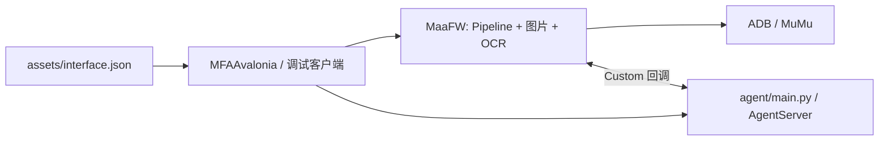

# Repository Guidelines

## Project Overview

MaaStarResonance 使用 MaaFramework 为星痕共鸣提供图像识别自动化，当前面向 Windows 上的 MuMu 模拟器，界面由 MFAAvalonia 提供。Docusaurus/React 仅用于文档站。

使用简体中文交流。涉及 MaaFW 协议时，先阅读 `MaaFWDocs/` 的相关章节；同一会话不重复通读。部分本地框架文档仍描述旧版本，新增代码应结合锁定的 MaaFW 版本和现有实现判断。

## Architecture & Data Flow

- `assets/interface.json` 声明控制器、任务 `entry`、选项和 Agent 启动方式，加载 `assets/resource/base/`。
  Pipeline 可独立运行；Python 是可选扩展，`attach` 是参数读取约定，不是必经执行层。
- `agent/main.py` 经 `agent/module_loader.py` 导入模块，触发自定义动作/识别器装饰器注册，再加载插件并启动 IPC。新子包需要 `__init__.py`；加载器跳过下划线开头的模块。
- `agent/plugin_loader.py` 与 `agent/plugin_registry.py` 管理侧载插件；插件及其依赖共享当前进程和解释器，不是沙箱，不自动加载不可信插件。

## Key Directories

| 路径 | 修改边界 |
| --- | --- |
| `agent/custom/` | 自定义动作、识别器及复用的游戏流程；优先复用 `general/` 中的公共动作。 |
| `agent/attach/`、`agent/utils/`、`agent/constant/` | 分别承载节点参数读取、通用工具、静态业务数据；部分常量在导入时读取相邻 JSON。 |
| `assets/resource/base/` | `pipeline/` 是流程源文件，`image/` 是识别模板，`model/ocr/` 是模型；不要改打包副本代替源文件。 |
| `docs/`、`src/`、`static/` | 中文文档、文档站 React 页面/CSS、站点静态资源；Python 核心不在 `src/`。 |
| `scripts/`、`.github/workflows/` | 环境初始化、资源检查、打包与 CI。脚本可能下载、覆盖或清理文件，不是通用的只读检查入口。 |

`deps/`、`MFA/` 是外部 SDK/UI，`install/` 是装配目录，根 `resource/` 保存 wheels、嵌入式 Python 等打包依赖。
`releases/` 是本地产物和缓存，非构建任务不扫描；`stash/` 是临时资料，除非明确指定，不读取。

## Development Commands

从仓库根目录执行；SDK、子模块和 OCR 准备见[快速开始](docs/开发者文档/content/快速开始.md)。

| 命令 | 用途与限制 |
| --- | --- |
| `uv sync` | 按项目依赖与锁文件创建或同步 `.venv`。 |
| `git submodule update --init --recursive` | 获取 OCR 等共享资源。 |
| `uv run python scripts/init_develop_environment.py` | 检查 SDK/子模块，首次复制中文 OCR 模型；不会刷新已存在的模型目录。 |
| `uv run python scripts/check_resource.py assets/resource/base` | 资源加载检查；不是单元测试或游戏流程测试。 |
| `uv run pre-commit run --all-files` | 现有格式/资源 hooks；Markdown 使用 `--fix`，可能修改文件，执行后检查实际改动。 |
| `npm ci` | 按 `package-lock.json` 安装文档站依赖。 |
| `npm start` | 启动文档开发服务器。 |
| `npm run docs:check` | 执行 Docusaurus 构建并检查链接；与 `npm run build` 相同，会生成产物。 |
| `npm run serve` | 预览已构建的文档站。 |

本地发行装配命令及清理副作用见[本地打包与 CI 边界](docs/开发者文档/content/开发随笔.md#本地打包与-ci-边界)。它不等同于 CI，也不是 MaaFramework 本身的 CMake 构建。

运行游戏任务应让 MFAAvalonia 或 Maa Pipeline Support 加载 `assets/interface.json`，连接 MuMu 后选择任务。
不要把直接运行 `agent/main.py` 当作独立应用或健康检查：它需要客户端提供 IPC 标识。

## Code Conventions & Common Patterns

- **Pipeline**：`assets/**/*.json` 按 JSONC 编辑；沿用目标文件的协议结构。`next` 按候选自身的识别结果选择首个命中项，错误分支使用 `on_error`；详细规则见下方专题。
- **命名与引用**：Python 使用 `snake_case` 函数/变量、`PascalCase` 类。节点名、注册名、`entry`、override 和 Python 节点字符串是跨文件契约，改名须同步全部引用。
- **参数与依赖**：通过 `Context` / `RunArg` 获取运行上下文，复用 `CustomActionParam` 和 `agent/attach/`。
  装饰器提供 Attach 函数的行为，只有 docstring 或 `...` 的函数体不是待实现桩；不另建配置副本或 DI 容器。
- **执行与状态**：沿用同步回调和 `post_*().wait()`；长循环检查 `context.tasker.stopping`，每次 `run` 重置任务状态。使用 `agent.logger.logger`，按回调契约返回失败，不能只记日志后伪报成功。
- **格式**：Python 四空格、类型提示、绝对导入；编辑器使用 Black，isort 配为 120 列，但二者没有 Python pre-commit hook。
  Prettier 的四空格、YAML 两空格及数组规则以 `.prettierrc` 为准，不全库重排。
- **文档**：沿用页面的 front matter、中文正文、带语言的代码块和相对链接。移动页面时同步侧栏、入口和首页引用。

## Important Files

按任务阅读专题，不将长教程复制回本文件：

| 任务 | 参考 |
| --- | --- |
| 新增功能、选择参数传递方式 | [添加功能](docs/knowledge/add-feature.md) |
| 修改节点、选项或 Python 扩展 | [修改功能](docs/knowledge/modify-feature.md) |
| 查阅节点、`next` / `on_error` / `[JumpBack]` | [Pipeline 参考](docs/knowledge/pipeline-reference.md) |
| 选择检查方式、调试和运行验收 | [测试与验收](docs/knowledge/test-feature.md) |
| 更新项目版本、同步依赖、打 tag 与正式发布 | [版本更新与发布](docs/knowledge/release-version.md) |
| 环境、站点维护和文档规范 | [开发者文档入口](docs/开发者文档/开发者文档入口.md) |

依赖和命令以 `pyproject.toml`、`uv.lock`、`package.json` 为准；
编辑器/schema 配置见 `.vscode/settings.json`，调试入口见 `.vscode/launch.json`。
实际 CI 以 `.github/workflows/check.yml`、`.github/workflows/install.yml` 为准；
文档导航由 `sidebars.js` 和 `docusaurus.config.js` 配置。

## Runtime/Tooling Preferences

- Python 使用 **uv**：最低 `3.11`，`.python-version` 选择 **3.13**；MaaFW 版本以 `pyproject.toml`、`uv.lock` 和 Android 固定配置为准。优先 `uv run`，不要依赖系统 Python 的包。
- 开发 PI 指向 `.venv/Scripts/python.exe`；跨平台构建矩阵不代表入口已跨平台适配。CI 打包 Windows x64/ARM64 与 Android arm64/x64，桌面 UI 构建需要 .NET 10；Android 工具链以 `android/build-config.json` 和工作流为准。
- 文档站使用 **Node.js >=20 + npm**，保留 `package-lock.json`，不新增第二套锁文件。
- 不输出或提交 `scripts/config.toml` 的令牌，不把 `assets/config/` 的本机路径当成通用默认值。迁移脚本先 `--dry-run`；变更日志生成和打包脚本会写文件，不作只读检查。

## Testing & QA

- 已有 Android 打包单测：`uv run python -m unittest discover -s tests -p test_android_packaging.py -v`；没有 npm `test` 或覆盖率门禁，不虚构测试通过结果。
- 资源加载不能替代 Python 注册验证或实际识别/点击。游戏流程变更需在 MuMu 中运行受影响入口，核验选项、完成、停止及异常路径；缺少场景时明确未验证范围。
- 文档/导航变更执行 `npm run docs:check` 并预览受影响页面；根 `AGENTS.md` 不在现有 Markdown hook 覆盖范围。各检查的版本差异、覆盖范围和副作用统一见[测试与验收](docs/knowledge/test-feature.md)。
